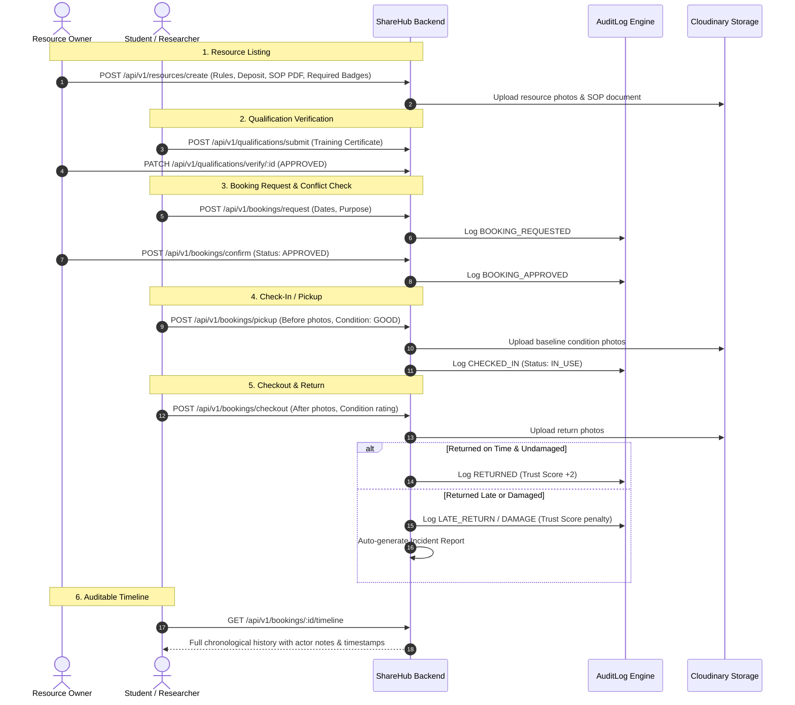

# 🚀 ShareHub — Trusted Institutional Resource & Equipment Sharing Platform

> **Hackathon Track:** *Unlock Underused Equipment and Spaces*  
> **One-Line Pitch:** A trusted institutional platform enabling universities, research labs, makerspaces, and tech facilities to safely share high-value idle equipment and spaces with verified researchers and creators through prerequisite gating, condition auditing, and immutable activity history.

---

## 📌 Table of Contents
- [The Problem](#-the-problem)
- [The Solution](#-the-solution)
- [Core Features](#-core-features)
- [System Architecture & Lifecycle](#-system-architecture--lifecycle)
- [Tech Stack](#-tech-stack)
- [Complete API Reference](#-complete-api-reference)
- [Step-by-Step Judge Testing Instructions](#-step-by-step-judge-testing-instructions)
- [Installation & Local Setup](#-installation--local-setup)
- [Trust, Safety & Fair Allocation Mechanics](#-trust-safety--fair-allocation-mechanics)
- [Future Possibilities](#-future-possibilities)

---

## 🎯 The Problem

Colleges, laboratories, makerspaces, and community organizations own valuable resources—ranging from 3D printers, CNC routers, and high-speed cameras to cleanrooms, testing chambers, and specialized computing clusters. 

However, **60% to 80% of this capacity remains locked away and unused** outside of formal lab hours, over weekends, and across term breaks. At the same time, nearby students, hardware founders, and independent researchers are blocked from innovation due to prohibitive capital costs.

### Why Ordinary Booking Tools Fail:
Conventional room/calendar booking systems (like Google Calendar or Calendly) only show *time availability*. They completely fail to address:
- **Safety & Competence:** No prerequisite verification to ensure the borrower is trained to operate dangerous or sensitive machinery.
- **Liability & Evidence:** No photographic baseline documenting the physical condition of equipment before and after use.
- **Operational Accountability:** No automated handling for overdue returns, missing parts, deposit forfeitures, or damages.
- **Fair Allocation:** Vulnerable to monopolization where single individuals or groups hoard limited equipment indefinitely.

---

## 💡 The Solution: ShareHub

**ShareHub** bridges this gap by embedding **trust, safety verification, and operational governance** directly into the sharing workflow. It gives equipment owners total control over their assets while providing borrowers transparent, fair, and documented access.

### 🌟 Key Pillars
1. **Prerequisite & Qualification Gating:** Restrict hazardous or sensitive equipment to users with approved safety badges or training certificates.
2. **Before-and-After Photographic Auditing:** Mandatory condition checklists and multi-angle photo uploads at both pickup and return, protecting both parties against wrongful blame.
3. **Automated Incident & Delay Detection:** Automatic detection of overdue returns, calculation of late hours, auto-filing of damage reports, and adjustment of dynamic user **Trust Scores**.
4. **Anti-Monopolization Safeguards:** Max-duration limits, lead times, and conflict-detection scheduling algorithms.
5. **Immutable Chronological Audit Trail:** Every action (request, review, condition photo, return sign-off, dispute resolution) is logged in a tamper-evident timeline for institutional compliance.

---

## ⚡ Core Features

| Feature | Description |
|---|---|
| **Role-Based Profiles** | Three distinct roles: `USER` (borrower/researcher), `OWNER` (lab manager/department in-charge), and `ADMIN` (institutional safety coordinator). |
| **Prerequisite Verification** | Users upload certifications (PDF/images) that must be verified by an admin or lab manager before booking high-risk resources. |
| **Conflict-Free Scheduling** | Real-time date-overlap detection prevents double-booking and returns clear rejection/waitlist rationales. |
| **Check-In Inspection** | Borrower uploads baseline condition rating, inspection notes, and multiple timestamped photos before unlocking equipment. |
| **Checkout & Return Sign-Off** | Borrower records final state with return photos. System automatically marks status, detects delays, and resets equipment status to `AVAILABLE`. |
| **Automated Late & Damage Engine** | Calculates late return hours, automatically flags status as `OVERDUE`, and auto-generates `LATE_RETURN` or `DAMAGE` incident reports. |
| **Dynamic Trust Score** | Every user starts with a Trust Score of 100. Punctual, clean returns reward `+2`; overdue returns deduct `-5` to `-15`; damages deduct `-15` to `-20`. |
| **Audit Trail (`AuditLog`)** | Full chronological activity history retrievable per booking via a single API call for judge/institutional review. |

---

## 🔄 System Architecture & Lifecycle

### 10-Step End-to-End Sharing Journey



---

## 🛠 Tech Stack

- **Runtime & Framework:** Node.js (v18+) & Express.js (v5.x)
- **Database:** MongoDB Atlas with Mongoose ODM (Data modeling, schema validation, population, timestamps)
- **File & Media Storage:** Cloudinary REST API (`uploadOnCloudinary` using parallel `Promise.all` streaming)
- **Authentication & Security:** JWT (JSON Web Tokens) with HttpOnly secure cookies, Bcrypt password hashing, and CORS credential handling
- **File Upload Middleware:** Multer (`multipart/form-data` disk storage pipeline)
- **Architecture Pattern:** Clean MVC (Model-View-Controller) with centralized `ApiError`, `ApiResponce`, and `asyncHandler` wrappers

---

## 📡 Complete API Reference

All protected endpoints require authentication via JWT HttpOnly cookie or `Authorization: Bearer <token>`.

### 1. User & Authentication (`/api/v1/users`)
| Method | Endpoint | Access | Description |
|---|---|---|---|
| `POST` | `/register` | Public | Register user with ID number, avatar, and optional cover image |
| `POST` | `/login` | Public | Login with email/username + password |
| `POST` | `/logout` | 🔒 Authenticated | Logout and invalidate JWT refresh token |
| `GET` | `/get_user` | 🔒 Authenticated | Retrieve current user profile and Trust Score |
| `POST` | `/change-password` | 🔒 Authenticated | Change account password with old-password verification |
| `POST` | `/update-details` | 🔒 Authenticated | Update full name or email address |
| `POST` | `/update-avatar` | 🔒 Authenticated | Upload and replace profile avatar |

### 2. Resources & Equipment (`/api/v1/resources`)
| Method | Endpoint | Access | Description |
|---|---|---|---|
| `GET` | `/` | Public | Browse/search resources (`?search=`, `?category=`, pagination) |
| `GET` | `/:resourceId` | Public | Get single resource specs and active reserved dates calendar |
| `POST` | `/create` | 🔒 Authenticated | List equipment + rules + deposit + photos + terms PDF |
| `GET` | `/my-resources` | 🔒 Authenticated | Owner dashboard: all listings by current user |
| `PATCH` | `/update/:resourceId` | 🔒 Owner Only | Update details, pricing, rules, or append new photos |
| `DELETE` | `/delete/:resourceId` | 🔒 Owner Only | Delete resource (blocked if active bookings exist) |
| `PATCH` | `/status/:resourceId` | 🔒 Owner Only | Toggle status (`AVAILABLE` / `MAINTENANCE`) |

### 3. Bookings & Lifecycle (`/api/v1/bookings`)
| Method | Endpoint | Access | Description |
|---|---|---|---|
| `POST` | `/request` | 🔒 Authenticated | Request booking with conflict check (`startDate`, `endDate`) |
| `POST` | `/confirm` | 🔒 Owner Only | Approve or reject request (rejection requires reason note) |
| `POST` | `/pickup` | 🔒 Authenticated | Check-in with baseline condition rating and before-photos |
| `POST` | `/checkout` | 🔒 Authenticated | Return item with return photos; auto-detects delays/damage |
| `GET` | `/my-bookings` | 🔒 Authenticated | Borrower dashboard: my active and past reservations |
| `GET` | `/owner-bookings` | 🔒 Authenticated | Owner dashboard: incoming requests for my resources |
| `GET` | `/:bookingId/timeline` | 🔒 Authenticated | **Audit Trail:** Chronological log of all booking events |

### 4. Qualifications & Induction (`/api/v1/qualifications`)
| Method | Endpoint | Access | Description |
|---|---|---|---|
| `POST` | `/submit` | 🔒 Authenticated | Submit safety badge / training certificate PDF |
| `GET` | `/my` | 🔒 Authenticated | List all qualifications held by logged-in user |
| `PATCH` | `/verify/:qualificationId` | 🔒 Admin / Owner | Approve or reject qualification proof |

### 5. Incidents & Disputes (`/api/v1/incidents`)
| Method | Endpoint | Access | Description |
|---|---|---|---|
| `POST` | `/create` | 🔒 Authenticated | Manually report damage, late return, or safety violation |
| `GET` | `/booking/:bookingId` | 🔒 Authenticated | List all incidents associated with a booking |
| `GET` | `/resource/:resourceId`| 🔒 Owner Only | List all incidents across a specific resource |
| `GET` | `/:incidentId` | 🔒 Authenticated | Detailed view of a single incident |
| `PATCH` | `/resolve/:incidentId` | 🔒 Owner Only | Resolve dispute, set penalty amount, deduct trust score |

---

## 🧪 Step-by-Step Judge Testing Instructions

Judges can complete a **full end-to-end sharing journey** without manual simulation:

```
[1. User Registration] ──> [2. Qualification Upload] ──> [3. Resource Listing]
           │
           ▼
[4. Booking Request]   ──> [5. Owner Approval]       ──> [6. Check-in (Before Photos)]
           │
           ▼
[7. Return (After Photos)] ──> [8. Auto-Incident (if late/damaged)] ──> [9. View Timeline]
```

1. **Register User A (Owner)** and **User B (Borrower)** via `POST /api/v1/users/register`.
2. **Submit Qualification:** User B uploads safety certificate via `POST /api/v1/qualifications/submit`.
3. **Verify Qualification:** User A (as Lab Manager) verifies it via `PATCH /api/v1/qualifications/verify/:id` (`status: "APPROVED"`).
4. **List Resource:** User A lists a 3D Printer via `POST /api/v1/resources/create` with required qualification `["3D_PRINTER_SOP"]`.
5. **Request Booking:** User B requests dates via `POST /api/v1/bookings/request`.
6. **Approve Booking:** User A reviews and approves via `POST /api/v1/bookings/confirm` (`status: "APPROVED"`).
7. **Check-In (Pickup):** User B uploads 2 pickup condition photos via `POST /api/v1/bookings/pickup`. Status becomes `CHECKED_IN`.
8. **Check-Out (Return):** User B uploads return photos via `POST /api/v1/bookings/checkout`. Status updates to `RETURNED`.
9. **View Auditable History:** Call `GET /api/v1/bookings/:bookingId/timeline` to see the complete, timestamped chronological audit trail of all actions, actors, and notes.

---

## 💻 Installation & Local Setup

### 1. Clone & Install Dependencies
```bash
git clone <repository-url>
cd backend
npm install
```

### 2. Configure Environment Variables
Create a `.env` file in the root directory:
```env
PORT=8000
MONGODB_URI=mongodb+srv://<username>:<password>@cluster.mongodb.net
CORS_ORIGIN=http://localhost:5173
ACCESS_TOKEN_SECRET=your_jwt_access_secret_key_here
ACCESS_TOKEN_EXPIRY=1d
REFRESH_TOKEN_SECRET=your_jwt_refresh_secret_key_here
REFRESH_TOKEN_EXPIRY=10d
CLOUDINARY_CLOUD_NAME=your_cloudinary_cloud_name
CLOUDINARY_API_KEY=your_cloudinary_api_key
CLOUDINARY_API_SECRET=your_cloudinary_api_secret
```

### 3. Start Development Server
```bash
npm run dev
```
The server will start on `http://localhost:8000` with live MongoDB connection.

---

## ⚖️ Trust, Safety & Fair Allocation Mechanics

### 1. Preventing Monopolization
- **Duration Limits (`maxBookingDays`):** Owners set hard caps (e.g., maximum 3 days per booking) preventing users from locking resources indefinitely.
- **Active Booking Guard:** System restricts users with unresolved overdue returns from creating new booking requests.

### 2. Reputation & Trust Scoring
- Initial borrower score: **100**.
- Successful, on-time return in good condition: **+2**.
- Overdue return: **-5** (minor delay), **-10** (24h+ delay), **-15** (48h+ delay).
- Damaged return: **-15** to **-20**.
- Resources can mandate a minimum trust score (e.g., score $\ge 80$) to book high-value equipment.

### 3. Photographic Proof of State
Baseline photos taken at check-in are immutable. When returning equipment, return photos are stored alongside the initial photos, allowing owners and judges to compare condition side-by-side during dispute resolution.

---

## 🔮 Future Possibilities

- **IoT Smart Locker & Access Control:** Integration with smart relays/RFID card readers to unlock lab doors and tool lockers only during confirmed active booking windows.
- **AI Condition Comparison:** Automated computer vision pipeline comparing before-and-after photos to detect new scratches, dents, or missing parts.
- **Inter-University Consortium:** Expanding resource sharing across regional academic clusters with standardized institutional credit transfers.

---

## 📄 License
This project is developed for the **48-Hour Hackathon: Unlock Underused Equipment and Spaces**. All rights reserved.
